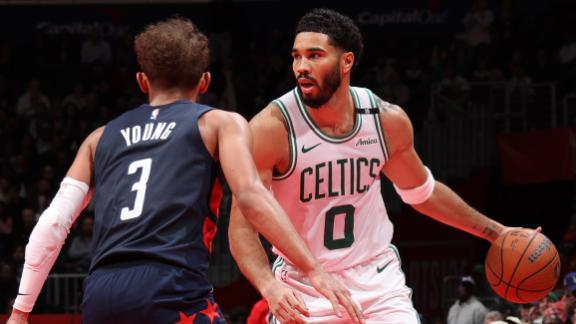
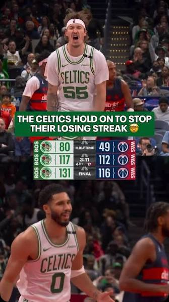
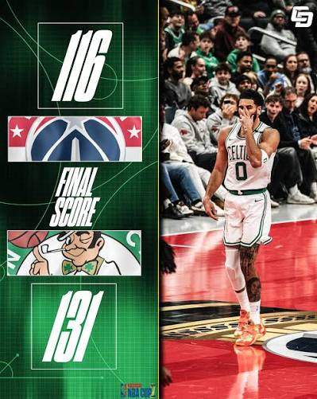

The Boston Celtics cruised into downtown Washington D.C. on Tuesday Night to take on the Wizards at Capital One Arena riding a 4-game losing streak. The last time they had a 4 game losing streak was 5 years prior in May of 2021. Going into the game as 10.5 point favorites, it appeared as though it would be an easy victory. The score at halftime would reflect that with a whopping 80-49 lead. However, the door wasn't fully closed as the Wizards crept back into the game eventually trimming the lead to single digits at 5 points with 3:11 left in the 4th Quarter. The Celtics would eventually regain their lead and slam the door on their near herculean comeback to cap off the 131-116 and get back in the win column.

