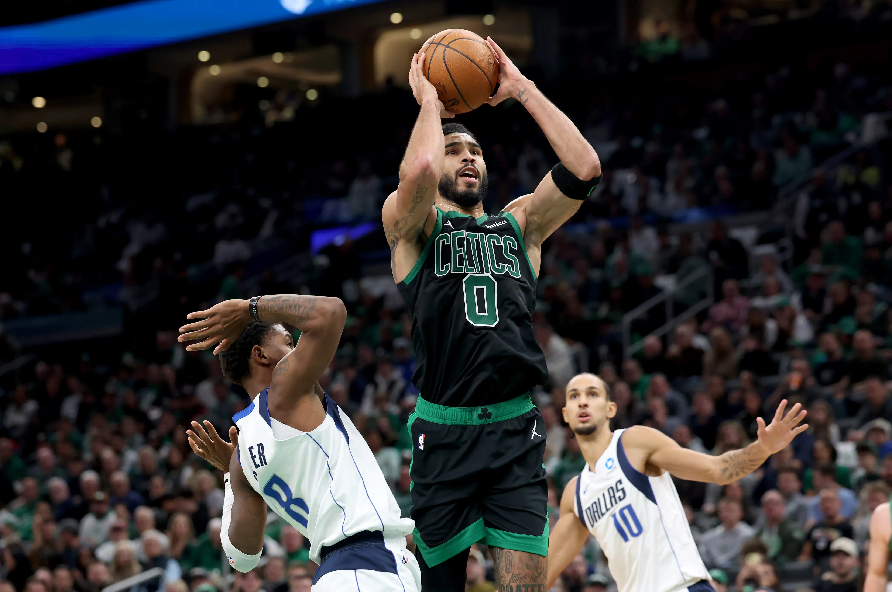
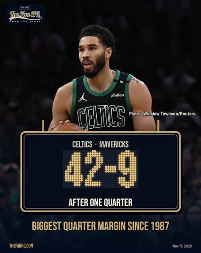
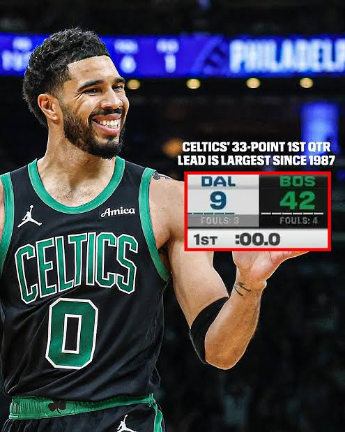

End Of First Quarter Score: Boston Celtics **42**, Dallas Mavericks **9**

Differential: +33 points (Celtics franchise record)

NBA History Context: Tied for the second-largest first-quarter lead in NBA history (matching the Baltimore Bullets in 1972) and trailing only the 1987 Los Angeles Lakers (+36 against the Kings).

Shooting & Stats: Boston shot 59.3% from the field and hit seven 3-pointers in the opening period, while Dallas shot 2-for-18 (11.1%) and 0-for-8 from deep.

Game Outcome: The Celtics cruised to a 131–94 blowout victory at TD Garden.
