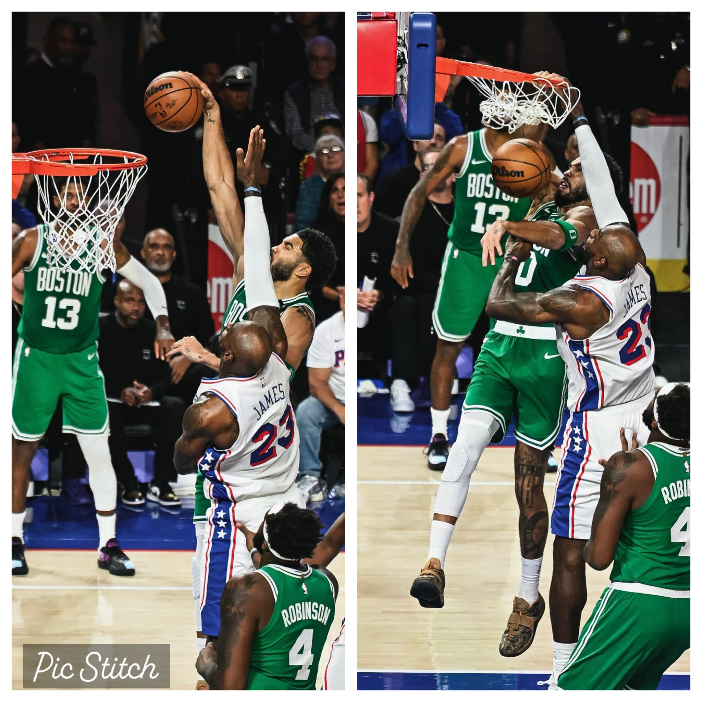
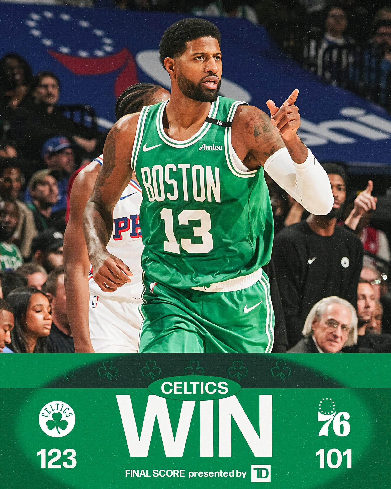
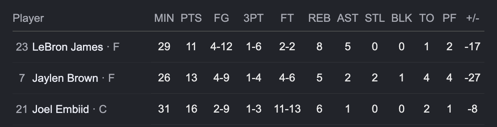
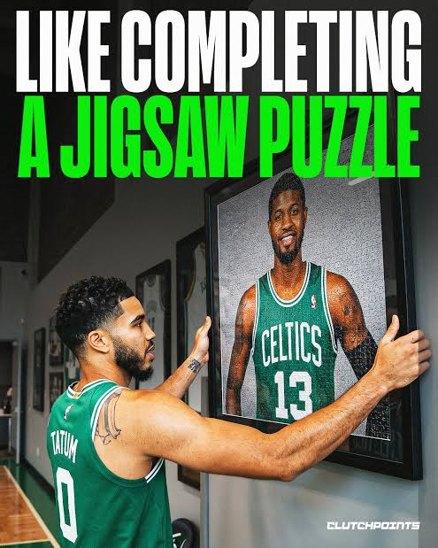

<https://www.youtube.com/watch?v=avFq9errZCk>

<https://www.youtube.com/watch?v=RvRjs3gCajM>

Led by the trio of PG-13 (36), Tatum (21) and Pritchard (18), the C's downed the 76ers in Philly on Tuesday night.

They played smothering D, shutting down the Big 3 of LeBron, Brown and Embiid to the tune of 10/30 FG, 3/13 from 3PT Land and a whopping 7 TOs.

Paul George continues to silence the critics with his stellar play thus proving that he is a exceptional fit within this newly revamped Celtics system. 

To be continued...
