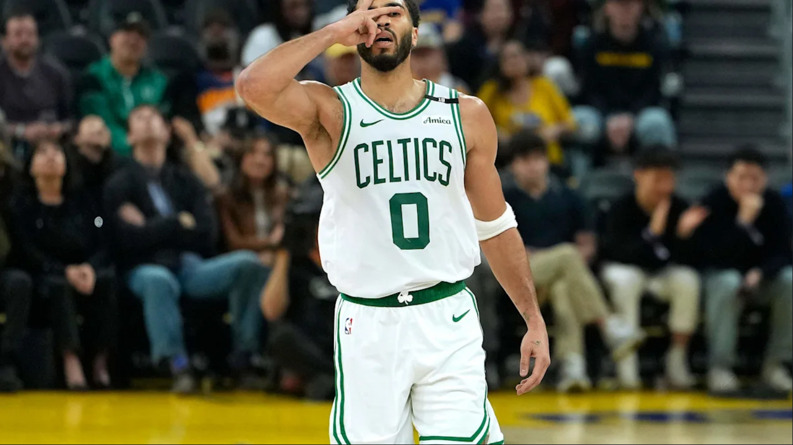
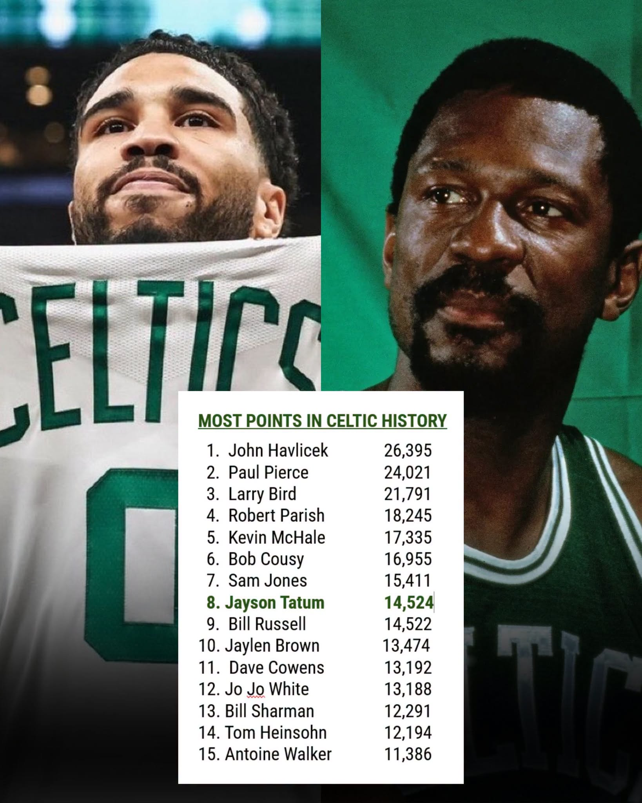
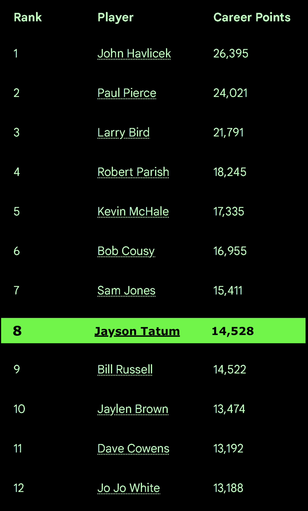
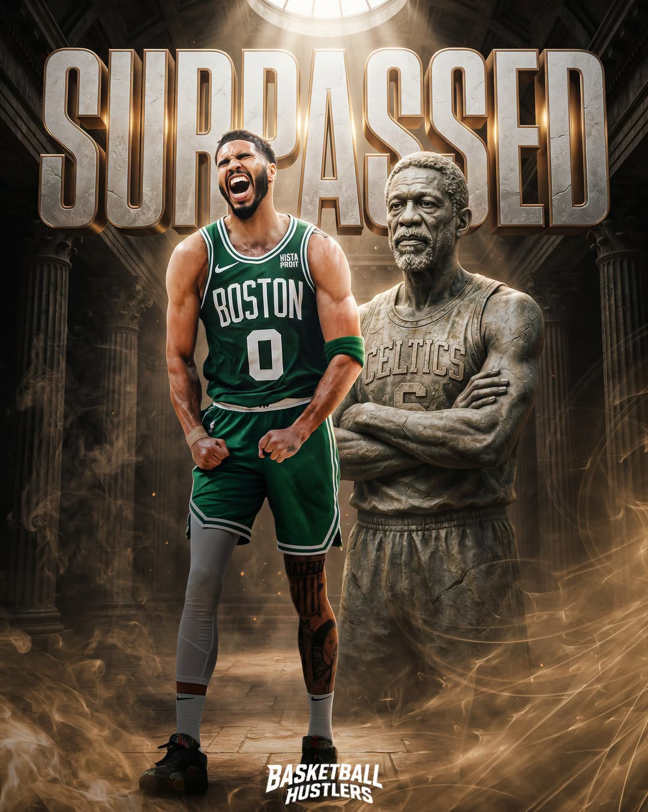

Milestone & Game Details:

Tatum entered the game in San Francisco needing 22 points to pass Russell's 14,522 career points. He scored 23 points in the first half and finished with 27 points, 10 rebounds, and 6 assists in Boston's 88–87 narrow loss.

•  Career Points After Game: 14,528 (surpassing Bill Russell's 14,522)

•  Celtics Scoring Rank: 8th all-time (trailing 7th-place Sam Jones at 15,411 and franchise leader John Havlicek at 26,395)

•  Milestone Shot: A long three-pointer over Draymond Green with seconds remaining before halftime
